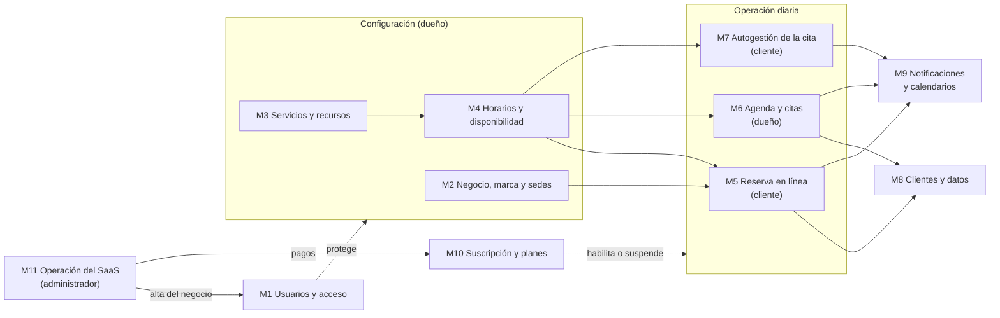

# Agenda de citas (SaaS) — Épicas e historias de usuario por módulo

| | |
|---|---|
| **Versión** | 0.1 (borrador) |
| **Fecha** | 2026-11-10 |
| **Fuentes** | [PRD.md](PRD.md) v0.9 · [DESIGN.md](DESIGN.md) v1.0 · [ARCHITECTURE.md](ARCHITECTURE.md) v0.14 |

> Este documento ordena los requerimientos del producto por **módulos funcionales**, para entender la aplicación de un vistazo: qué partes tiene, quién usa cada una y qué debe poder hacer.
>
> Los módulos son **una forma de leer el producto, no una arquitectura**. La aplicación sigue siendo una sola (ARCH §2 y §4): un módulo de este documento no es un paquete, un servicio ni una carpeta del código, y varios módulos comparten las mismas tablas y casos de uso.
>
> Las reglas detalladas siguen en el PRD (RN, D y S) y el cómo en ARCHITECTURE. Cada historia cita su origen. Si este documento difiere del PRD, **prevalece el PRD**.

---

## 1. Cómo leer este documento

- **Módulo:** un área del producto que se entiende por sí sola (por ejemplo, "Reserva en línea").
- **Épica:** un objetivo grande dentro del módulo, que agrupa varias historias.
- **Historia:** una necesidad concreta, escrita como *"Como \<actor\>, quiero \<acción\>, para \<beneficio\>"*, con sus criterios de aceptación.

Cada historia lleva:

| Campo | Significado |
|---|---|
| **ID** | Prefijo del módulo y número (`RES-03`). Los prefijos no repiten los del PRD (`PUB`, `GES`, `PAN`, `ADM`) para no confundirlos. |
| **Alcance** | **MVP** (entra en la primera versión) o **Posterior** (el modelo está preparado, pero la funcionalidad se construye después). |
| **Criterios** | Lo mínimo que debe cumplirse para darla por buena. El detalle exacto está en las reglas citadas. |
| **Refs** | Funcionalidades, reglas y decisiones del PRD, y secciones de ARCH o DESIGN. |

### Avance

Una historia terminada lleva ✅ al inicio de su título, por ejemplo: **✅ RES-03. Elegir el día** · MVP. Una épica lleva ✅ cuando todas sus historias MVP están terminadas. Lo que no tiene ✅ sigue pendiente.

### Actores

| Actor | Quién es | Cómo entra |
|---|---|---|
| **Cliente** | Quien reserva una cita (por ejemplo, el paciente de la optometría). | Página pública y link de gestión, sin cuenta. |
| **Dueño** | Quien atiende y administra el negocio. | Panel (`/panel`), con correo y contraseña. |
| **Administrador** | Quien opera el SaaS. | Panel interno (`/admin`). |
| **Sistema** | Las tareas automáticas (cron cada 5 minutos, envío de correos). | — |

---

## 2. Mapa de módulos

| # | Módulo | Prefijo | Qué resuelve | Actores | Historias (MVP + posteriores) |
|---|---|---|---|---|---|
| M1 | [Usuarios y acceso](#m1-usuarios-y-acceso) | `ACC` | Quién entra al sistema y qué puede ver | Dueño, administrador | 5 + 1 |
| M2 | [Negocio, marca y sedes](#m2-negocio-marca-y-sedes) | `NEG` | La identidad del negocio y dónde atiende | Dueño | 6 + 1 |
| M3 | [Servicios y recursos](#m3-servicios-y-recursos) | `SER` | Qué se ofrece y con qué capacidad | Dueño | 4 + 2 |
| M4 | [Horarios y disponibilidad](#m4-horarios-y-disponibilidad) | `DIS` | Cuándo se atiende y qué horas están libres | Dueño, sistema | 6 |
| M5 | [Reserva en línea](#m5-reserva-en-línea) | `RES` | Que el cliente reserve solo desde el celular | Cliente | 9 + 1 |
| M6 | [Agenda y citas](#m6-agenda-y-citas) | `AGE` | Que el dueño gestione todas sus citas en un lugar | Dueño, sistema | 7 |
| M7 | [Autogestión de la cita](#m7-autogestión-de-la-cita) | `AUT` | Que el cliente cancele o cambie su cita sin llamar | Cliente | 4 |
| M8 | [Clientes y protección de datos](#m8-clientes-y-protección-de-datos) | `CLI` | Conocer a los clientes y cumplir la Ley 1581 | Dueño, sistema | 6 |
| M9 | [Notificaciones y calendarios](#m9-notificaciones-y-calendarios) | `NOT` | Avisar a tiempo y llevar las citas al calendario | Cliente, dueño, sistema | 6 + 1 |
| M10 | [Suscripción y planes](#m10-suscripción-y-planes) | `SUS` | Qué puede usar cada negocio y qué pasa si no paga | Dueño, sistema | 4 + 1 |
| M11 | [Operación del SaaS](#m11-operación-del-saas) | `OPE` | Dar de alta negocios, registrar pagos y vigilar la operación | Administrador | 6 |

Además, hay requisitos que atraviesan todos los módulos (multi-negocio, hora local, seguridad, accesibilidad…). Están en la [sección 4](#4-requisitos-transversales).

### Cómo se relacionan

En palabras: el dueño **configura** su negocio (M2 a M4); con eso, el motor de disponibilidad sabe qué horas ofrecer, y la **operación diaria** ocurre en tres frentes: el cliente reserva (M5) o gestiona su cita (M7), y el dueño administra la agenda (M6). Cada cita alimenta la ficha del cliente (M8) y dispara correos (M9). Por encima, la suscripción (M10) decide si todo eso está habilitado, y el administrador (M11) da de alta negocios y registra pagos.

---

## 3. Módulos

### M1. Usuarios y acceso

**Propósito:** que solo las personas autorizadas entren al panel y que cada dueño vea únicamente su negocio. Los clientes **no tienen cuenta** (RN-17).

**Fuera del MVP:** varios usuarios por negocio y permisos (`multi_user`).

#### ACC-E1. Ingreso del dueño

**ACC-01. Activar mi cuenta desde la invitación** · MVP
Como **dueño invitado**, quiero definir mi contraseña desde el correo de invitación, para entrar a mi panel sin tener que registrarme por mi cuenta.
- La invitación lleva a `/registro`, donde el dueño define su contraseña. Su correo queda confirmado.
- En el primer ingreso, la cuenta se vincula al negocio por el correo principal verificado.
- Nadie puede registrarse sin invitación.
- *Refs:* F-05, PAN-01, D-08; ARCH §7.2, §7.4, ADR-05, ADR-06.

**✅ ACC-02. Iniciar y cerrar sesión** · MVP
Como **dueño**, quiero entrar con mi correo y contraseña y cerrar sesión cuando termine, para proteger la información de mi negocio.
- Sin sesión, `/panel` redirige a `/login`. Al cerrar sesión se vuelve a `/login`.
- Un usuario con sesión válida pero sin negocio asignado ve la pantalla "sin acceso".
- *Refs:* PAN-01, RNF-04; ARCH §7.3, §7.5.

**ACC-03. Recuperar y cambiar mi contraseña** · MVP
Como **dueño**, quiero cambiar mi contraseña y recuperarla si la olvido, para no perder el acceso a mi agenda.
- El cambio y la recuperación funcionan por correo, sin intervención del administrador.
- *Refs:* PAN-01; ARCH §7.1.

**ACC-04. Ver solo los datos de mi negocio** · MVP
Como **dueño**, quiero que el panel me muestre únicamente la información de mi negocio, para que mis datos y los de mis clientes no se mezclen con los de otros.
- El negocio sale de la sesión, nunca de un parámetro que envíe el navegador.
- Si se manipulan identificadores para llegar a citas, clientes o servicios de otro negocio, la respuesta es "no encontrado" y no se ve ni se cambia nada.
- *Refs:* RN-01; ARCH §6.

#### ACC-E2. Acceso del administrador

**ACC-05. Entrar al panel interno** · MVP
Como **administrador**, quiero un panel `/admin` al que solo yo pueda entrar, para operar el SaaS sin exponerlo.
- Solo entran los usuarios autorizados en la configuración del servidor.
- Cualquier otro usuario, con sesión o sin ella, recibe una página "no encontrado": no se revela que `/admin` existe.
- *Refs:* §3 del PRD; ARCH §7.5, ADR-07.

#### ACC-E3. Equipo del negocio

**ACC-06. Invitar a otras personas al panel** · Posterior
Como **dueño**, quiero invitar a otras personas de mi equipo con un rol, para repartir la gestión de la agenda.
- Se habilita con la funcionalidad `multi_user` y se limita con `max_users`.
- *Refs:* PRD §4.2; ARCH §7.8.

---

### M2. Negocio, marca y sedes

**Propósito:** que la página pública muestre la identidad del negocio y que el cliente sepa dónde y cómo contactarlo.

**Fuera del MVP:** la interfaz para varias sedes. El modelo de sedes ya existe: todo negocio tiene una "Sede principal", que el dueño no ve como concepto (D-16).

#### NEG-E1. Identidad y marca

**NEG-01. Configurar la marca de mi negocio** · MVP
Como **dueño**, quiero definir el nombre, el rubro, el eslogan, la frase del banner, la descripción y los colores de mi negocio, para que la página de reservas se vea como mía.
- El nombre es obligatorio; los demás textos son opcionales y tienen un largo máximo.
- Los colores se eligen en formato `#rrggbb`. Si el color no da contraste suficiente, los textos usan un color alternativo legible.
- *Refs:* PAN-11, PUB-01, D-27, RNF-03; DESIGN §2.1; Q-38 y Q-42 de TASKS-04.

**NEG-02. Subir el logo** · MVP
Como **dueño**, quiero subir el logo de mi negocio, para que mis clientes me reconozcan.
- Se aceptan PNG, JPEG o WebP de hasta 512 KB, sin SVG. Al cambiarlo, el anterior se borra.
- Sin logo, se muestra la inicial del nombre.
- *Refs:* PAN-11; ARCH §19.2; DESIGN §3 (mosaico de logo); Q-43 de TASKS-04.

**NEG-03. Publicar mis contactos** · MVP
Como **dueño**, quiero registrar una lista de contactos (WhatsApp, teléfono y correo), para que mis clientes me encuentren por el canal que prefieran.
- Hasta 6 contactos, en el orden que elija el dueño, con una etiqueta opcional.
- Aparecen en la página pública, en el link de gestión cuando el cliente ya no puede actuar y en el aviso de negocio suspendido.
- *Refs:* D-29, PUB-01, PUB-07, AUT-04; ARCH §18.4.

**NEG-04. Indicar la dirección** · MVP
Como **dueño**, quiero registrar la dirección de mi consultorio, para que el cliente sepa cómo llegar.
- La dirección aparece en la página pública, en los correos y en el link de gestión, con un enlace a Google Maps (sin Waze).
- *Refs:* PAN-11, PUB-01, C-01, D-30.

#### NEG-E2. Sedes

**NEG-05. Tener una sede principal sin configurarla** · MVP
Como **dueño**, quiero configurar "mi" horario y "mi" dirección sin pensar en sedes, porque atiendo en un solo lugar.
- Todo negocio nace con la "Sede principal", con su consultorio de capacidad 1.
- Con una sola sede, la página pública y el panel se ven igual que si el concepto no existiera.
- *Refs:* RN-32, D-16, F-11.

**NEG-06. Atender en varias sedes** · Posterior
Como **dueño con varias sedes**, quiero crear y gestionar cada sede con su dirección, horario, bloqueos y servicios, para recibir reservas en todas.
- La cantidad de sedes activas la limita el plan (`max_locations`). No se puede desactivar la última sede activa.
- El cliente elige la sede en la misma página `/{slug}` y el calendario del panel se filtra por sede.
- *Refs:* RN-32, D-16, PRD §4.2; ARCH §5, ADR-15.

#### NEG-E3. Puesta en marcha

**NEG-07. Saber qué me falta para empezar a recibir reservas** · MVP
Como **dueño nuevo**, quiero una lista de lo que me falta configurar, para dejar mi página lista sin adivinar.
- La lista muestra marca, servicios, horario, reglas de reserva, recordatorio y política de datos, cada uno como "Listo" o "Falta".
- El panel muestra el enlace a la página pública.
- Mientras no haya al menos un servicio activo y un horario, la página pública dice "Aún no hay horarios disponibles", con los contactos.
- *Refs:* F-05, PAN-18; DESIGN §4.3 (Inicio).

---

### M3. Servicios y recursos

**Propósito:** definir **qué** puede reservar el cliente y **cuántas** citas simultáneas puede atender el negocio.

**Fuera del MVP:** precio por servicio (D-25) y la atención "por empleados" con nombre y foto (D-17, D-24).

#### SER-E1. Catálogo de servicios

**SER-01. Crear y editar mis servicios** · MVP
Como **dueño**, quiero crear servicios con nombre, descripción, categoría, duración y tiempo de preparación posterior (buffer), para que el cliente reserve exactamente lo que necesita.
- La duración y el buffer salen del servicio: el dueño agenda servicios, no bloques de tiempo. El buffer es 0 por defecto.
- Cada servicio nuevo se ofrece en la sede principal con su consultorio.
- No se muestran ni se guardan precios.
- La cantidad de servicios activos la limita el plan (`max_services`).
- *Refs:* PAN-12, RN-05, RN-06, D-02, D-25; ARCH §18.4 (`guardarServicio`).

**SER-02. Activar y desactivar servicios** · MVP
Como **dueño**, quiero desactivar un servicio sin borrarlo, para dejar de ofrecerlo sin perder su historial.
- Un servicio inactivo no aparece en la página pública ni admite reservas nuevas.
- Sus citas existentes se conservan y se siguen mostrando.
- *Refs:* PAN-12, RN-05, RN-28.

**SER-03. Agrupar los servicios por categoría** · MVP
Como **dueño**, quiero clasificar mis servicios en categorías, para que el cliente encuentre más rápido lo que busca.
- El panel sugiere las categorías que ya existen, para evitar variantes del mismo nombre.
- En la página pública, el cliente filtra con "Todos" y una opción por categoría. Sin categorías, no hay filtro.
- *Refs:* D-26, PUB-02; Q-39 de TASKS-04.

#### SER-E2. Capacidad

**SER-04. Configurar mi consultorio** · MVP
Como **dueño**, quiero definir el nombre y la capacidad de mi consultorio, para que el sistema acepte tantas citas simultáneas como puedo atender.
- La capacidad es un número entero de 1 en adelante.
- *Refs:* PAN-13, RN-06; ARCH §18.4 (`guardarConsultorio`).

#### SER-E3. Quién atiende

**SER-05. Registrar a mis empleados** · Posterior
Como **dueño**, quiero registrar a las personas que atienden, con nombre, foto, descripción, correo opcional y horario propio, para asignarles citas.
- Un empleado no es un usuario del sistema y siempre tiene capacidad 1.
- Su horario propio debe caber dentro del de la sede; sus ausencias se registran como bloqueos suyos.
- Los empleados cuentan para `max_resources`. El negocio debe tener la autorización de cada empleado para publicar su foto y su nombre.
- *Refs:* RN-33, D-17, D-19; ARCH §18.4 (`guardarEmpleado`), ADR-16.

**SER-06. Configurar un servicio "por empleados"** · Posterior
Como **dueño**, quiero indicar qué empleados atienden cada servicio y si el cliente puede elegir quién lo atiende, para ofrecer una experiencia personalizada.
- Requiere la funcionalidad `resource_per_service`.
- El panel advierte que no se deben mezclar empleados con un espacio anónimo que represente a las mismas personas, porque se sobrevende.
- *Refs:* RN-33, D-18; ARCH §10.3.

---

### M4. Horarios y disponibilidad

**Propósito:** que el sistema solo ofrezca horas en que el negocio realmente puede atender, y que **nunca** acepte una doble reserva (O-2).

Este módulo contiene el **motor de disponibilidad**: la misma regla decide qué horas se muestran en la página pública, en el panel y en el link de gestión.

#### DIS-E1. Horario de atención

**DIS-01. Definir mi horario semanal** · MVP
Como **dueño**, quiero definir para cada día de la semana una o varias franjas de atención, para incluir pausas como la hora del almuerzo.
- Las franjas de un mismo día no se pueden solapar.
- Cada franja es independiente: una cita debe caber completa en una sola franja, aunque dos franjas sean contiguas.
- *Refs:* PAN-14, RN-07, D-12.

#### DIS-E2. Bloqueos

**DIS-02. Bloquear horas o días** · MVP
Como **dueño**, quiero bloquear una hora, un día completo o un rango de días, con un motivo opcional, para no recibir citas cuando no voy a atender.
- Si en el rango hay citas confirmadas que aún no terminan, el bloqueo no se crea y el panel lista esas citas para moverlas o cancelarlas primero.
- Una vez creado, esas horas dejan de ofrecerse en todas partes.
- *Refs:* PAN-08, F-09, RN-07, D-15.

**DIS-03. Ver y quitar mis bloqueos** · MVP
Como **dueño**, quiero ver mis bloqueos vigentes y futuros y eliminar los que ya no aplican, para volver a abrir esas horas.
- Sin bloqueos, el panel dice "No hay bloqueos próximos."
- *Refs:* PAN-08; DESIGN §5.

#### DIS-E3. Reglas de reserva

**DIS-04. Configurar las reglas de reserva** · MVP
Como **dueño**, quiero decidir cada cuánto empiezan las citas, con cuánta anticipación se puede reservar, hasta cuándo se puede cancelar, cuántas veces puede reprogramar el cliente y qué pasa con la asistencia si no la marco, para que la agenda funcione a mi manera.
- Granularidad: 15, 30 o 60 minutos, alineada al reloj (con 30: en :00 y :30).
- Anticipación mínima y máxima, y plazo de cancelación, en horas o días.
- Límite de reprogramaciones del cliente: un número, vacío (sin límite) o 0 (no se permite).
- Asistencia por defecto: "asistió", "no asistió" o "siempre decido yo".
- Un negocio nuevo empieza con 30 minutos, 2 horas, 60 días, 24 horas, 3 reprogramaciones y "asistió".
- *Refs:* PAN-15, RN-08, RN-09, RN-13, RN-16, RN-34, D-09, D-20, D-21, S-02.

#### DIS-E4. Motor de disponibilidad

**DIS-05. Ofrecer solo horas realmente libres** · MVP
Como **dueño**, quiero que el sistema solo ofrezca horas en las que puedo atender, para no tener que corregir reservas imposibles.
- Una hora se ofrece solo si el servicio completo (duración más buffer) cabe en una franja, no toca un bloqueo, está alineada con la granularidad, respeta la anticipación y hay cupo en todo el intervalo.
- Todas las citas ocupan cupo, excepto las canceladas. Una cita que termina a las 9:30 no choca con una que empieza a las 9:30.
- Las horas se calculan y se muestran en hora de Colombia, sin importar la zona del dispositivo.
- La disponibilidad de una semana responde en menos de 500 ms.
- *Refs:* RN-03, RN-09, RN-10, S-04, RNF-07; ARCH §9, §10.

**DIS-06. Impedir las dobles reservas** · MVP
Como **dueño**, quiero que dos personas nunca puedan quedarse con el mismo último cupo, para no tener que llamar a nadie a cancelarle.
- La verificación del cupo y la creación de la cita ocurren en una sola transacción.
- Con 10 reservas simultáneas por el último cupo, entran exactamente tantas como la capacidad; las demás reciben "horario no disponible".
- Una hora que no se ofrece tampoco se puede reservar con una solicitud directa al servidor.
- *Refs:* O-2, RN-09, RN-11, RNF-06; ARCH §11.

---

### M5. Reserva en línea

**Propósito:** que el cliente reserve solo, a cualquier hora y desde el celular, en `tuapp.com/{slug}` (O-1).

**Fuera del MVP:** elegir quién atiende (F-13) y pagar en línea.

#### RES-E1. Conocer el negocio y elegir el servicio

**RES-01. Ver la página del negocio** · MVP
Como **cliente**, quiero ver el nombre, el logo, la descripción, la dirección, los horarios y los contactos del negocio, para confiar en él antes de reservar.
- La página funciona desde 360 px de ancho y carga rápido en 4G (LCP < 2,5 s).
- Muestra el enlace a Google Maps y los contactos con botones de 48 px.
- *Refs:* PUB-01, RNF-01, RNF-03, D-27, D-29, D-30; DESIGN §4.1.

**RES-02. Elegir el servicio** · MVP
Como **cliente**, quiero ver los servicios con su descripción y duración, y filtrarlos por categoría, para elegir el que necesito.
- Solo aparecen los servicios activos. No se muestran precios.
- *Refs:* PUB-02, RN-05, D-25, D-26.

#### RES-E2. Elegir día y hora

**RES-03. Elegir el día** · MVP
Como **cliente**, quiero un calendario que me muestre qué días tienen cupo, para no perder tiempo en días llenos.
- Solo se pueden elegir días dentro de la anticipación máxima. Los días sin cupo aparecen deshabilitados con "Sin cupos".
- Al entrar, se elige el primer día con cupo. Si el día elegido no tiene horas, se ofrece el siguiente día con cupo.
- *Refs:* PUB-03, F-01, RN-09; Q-43 y Q-48 de TASKS-04.

**RES-04. Elegir la hora** · MVP
Como **cliente**, quiero ver las horas libres del día elegido, para escoger la que me sirve.
- Las horas siempre están en hora de Colombia, en formato de 12 horas.
- *Refs:* PUB-04, RN-03, RNF-02; DIS-05.

#### RES-E3. Datos y confirmación

**RES-05. Dar mis datos y aceptar la política** · MVP
Como **cliente**, quiero dar mi nombre, apellido, celular y correo, y aceptar la política de datos, para confirmar mi reserva sin crear una cuenta.
- Los cuatro datos y la casilla de la política son obligatorios. El celular trae `+57` por defecto.
- La casilla enlaza a la versión vigente de la política, y se guarda la versión que el cliente vio y la fecha de aceptación, aunque el dueño publique otra mientras el cliente llena el formulario.
- Los errores aparecen junto a cada campo.
- *Refs:* PUB-05, RN-17, F-01; ARCH §18.5; Q-45 y Q-46 de TASKS-04.

**RES-06. Confirmar aunque alguien se me adelante** · MVP
Como **cliente**, quiero que, si alguien toma mi hora justo antes que yo, el sistema me avise sin borrar lo que escribí, para elegir otra hora sin empezar de nuevo.
- El aviso dice "Esa hora se acaba de ocupar. Elige otra; tus datos se conservan." y vuelve a las horas libres.
- *Refs:* F-01, RN-11; DESIGN §4.1.

**RES-07. Recibir la confirmación** · MVP
Como **cliente**, quiero ver que mi cita quedó confirmada, con un código fácil de dictar, para tener la tranquilidad de que está reservada.
- La pantalla muestra el servicio, la fecha, la hora, la dirección y el código de reserva (por ejemplo, `OV-4821`), y permite reservar otra cita.
- Indica que el correo de confirmación trae el link para gestionar la cita y la invitación de calendario.
- *Refs:* PUB-06, D-28, RN-12; NOT-01; Q-41 y Q-43 de TASKS-04.

#### RES-E4. Cuando no se puede reservar

**RES-08. Frenar las reservas basura** · MVP
Como **dueño**, quiero que la página limite las solicitudes repetidas desde un mismo origen, para que nadie llene mi agenda con reservas falsas.
- Desde un mismo origen, la sexta reserva en un minuto recibe "Hiciste muchas solicitudes seguidas. Intenta en un minuto." y no crea nada.
- Un campo trampa invisible detecta a los bots.
- *Refs:* PUB-08, RN-23, D-10; ARCH §15.

**RES-09. Saber por qué no puedo reservar** · MVP
Como **cliente**, quiero un mensaje claro cuando el negocio no recibe reservas, con sus contactos, para comunicarme por otro medio.
- Negocio suspendido: "Reservas no disponibles". En el período de gracia todo funciona normal.
- Negocio sin servicios u horario: "Aún no hay horarios disponibles".
- *Refs:* PUB-07, F-05, RN-04, RN-31.

#### RES-E5. Elegir quién me atiende

**RES-10. Elegir a la persona que me atiende** · Posterior
Como **cliente**, quiero ver a las personas que atienden el servicio, con su foto, y elegir a una o tomar "Sin preferencia", para atenderme con quien prefiero.
- Al elegir a alguien, solo veo sus horas libres. Con "Sin preferencia", veo las horas con al menos una persona libre y el sistema asigna una.
- La confirmación dice quién me atenderá.
- *Refs:* F-13, RN-33, D-18, D-24.

---

### M6. Agenda y citas

**Propósito:** que el dueño tenga **toda** su agenda en un solo lugar, incluidas las citas que llegan por WhatsApp o por teléfono (O-4).

El ciclo de vida completo de una cita (estados y transiciones) está en el [PRD §7](PRD.md#7-ciclo-de-vida-de-una-cita).

#### AGE-E1. Ver la agenda

**AGE-01. Ver mi agenda por día, semana y mes** · MVP
Como **dueño**, quiero ver mis citas por día, por semana y por mes, para organizar mi jornada y planear con tiempo.
- La vista de día muestra las citas, los bloqueos y el horario, en hora local. La de semana va de lunes a domingo.
- La vista de mes muestra cuántas citas activas hay cada día, y es lo primero que se recorta si el plazo aprieta.
- Sin citas, la vista de día dice "No tienes citas hoy."
- *Refs:* PAN-02, RN-03, PRD §4.3; DESIGN §4.3, §5; Q-52 de TASKS-05.

**AGE-02. Ver el detalle de una cita** · MVP
Como **dueño**, quiero ver el cliente, su contacto, el servicio, el estado, el código y el historial de cambios de una cita, para atenderla con toda la información.
- El detalle muestra solo las acciones que la cita permite en ese momento.
- Puedo encontrar una cita por su código de reserva cuando el cliente me lo dicta.
- *Refs:* PAN-03, D-28, RN-12; ARCH §18.4 (`detalleCita`, `buscarCitaPorCodigo`).

#### AGE-E2. Citas manuales

**AGE-03. Registrar una cita que llegó por otro canal** · MVP
Como **dueño**, quiero crear una cita desde el panel para un cliente existente o nuevo, para tener en la agenda también las que me piden por WhatsApp o por teléfono.
- Busco al cliente por teléfono o por nombre, o escribo sus datos; el correo es opcional.
- Elijo el servicio y una de **sus** horas libres. Se aplican las mismas reglas que en la página pública, salvo la anticipación mínima y máxima. No hay sobrecupo.
- Si la hora se ocupó mientras tanto, veo "Esa hora ya no está disponible" y la lista se actualiza.
- La cita lleva código de reserva. Si el cliente tiene correo, recibe la confirmación.
- *Refs:* PAN-04, F-06, RN-15, D-01, D-11, S-05; ARCH §18.4 (`crearCitaManual`).

#### AGE-E3. Cambios en las citas

**AGE-04. Mover una cita** · MVP
Como **dueño**, quiero pasar una cita a otra hora libre del mismo servicio, para acomodar a un cliente que me pide el cambio.
- Solo se mueven citas confirmadas. No aplica el plazo de cancelación del cliente.
- El cambio no gasta las reprogramaciones del cliente.
- El cliente recibe el aviso de reprogramación, que mueve el evento en su calendario.
- Si otra persona cambió la cita mientras tanto, el panel avisa en lugar de sobrescribir.
- Para cambiar de servicio, se cancela la cita y se crea una nueva.
- *Refs:* PAN-05, F-07, RN-14, RN-15, D-20, S-07; ARCH §18.4 (`moverCita`).

**AGE-05. Cancelar una cita** · MVP
Como **dueño**, quiero cancelar una cita en cualquier momento, para liberar el cupo cuando el cliente o yo no podemos asistir.
- Pide confirmación en dos pasos. La cita pasa a "cancelada", libera el cupo de inmediato y no se puede reactivar.
- El cliente recibe el aviso de cancelación, que quita el evento de su calendario.
- *Refs:* PAN-06, F-07, RN-10, RN-15, S-08.

#### AGE-E4. Asistencia

**AGE-06. Marcar si el cliente asistió** · MVP
Como **dueño**, quiero marcar cada cita como "Asistió" o "No asistió", para saber quién falta a sus citas.
- Los botones aparecen solo después de la hora de inicio.
- Puedo corregir la marca entre "Asistió" y "No asistió".
- El cliente no recibe correo.
- *Refs:* PAN-07, F-08, RN-16, S-09.

**AGE-07. Marcar la asistencia automáticamente** · MVP · *Sistema*
Como **dueño**, quiero que, si no marco una cita, el sistema le aplique mi asistencia por defecto al terminar, para no tener citas eternamente pendientes.
- Con "asistió", una cita de 9:00 a 9:30 sin marcar queda "Asistió" a más tardar a las 9:35, como "marcada automáticamente".
- Con "siempre decido yo", la cita queda pendiente hasta que la marque.
- No se aplica con el negocio suspendido; se aplica al reactivarlo.
- *Refs:* F-08, RN-16, D-21, DIS-04; ARCH §18.4 (`aplicarAsistenciaPorDefecto`).

---

### M7. Autogestión de la cita

**Propósito:** que el cliente cancele o cambie su cita sin cuenta y sin llamar, desde el link que llega en sus correos.

#### AUT-E1. Gestionar mi cita por link

**AUT-01. Ver mi cita** · MVP
Como **cliente**, quiero abrir el link de mi correo y ver mi cita, para recordar cuándo y dónde es.
- Muestra el código, el servicio, la fecha, la hora, la dirección, el estado y los contactos del negocio.
- El link es único e impredecible. Un link alterado responde "no encontrado".
- *Refs:* GES-01, RN-13; ARCH §13, §18.4 (`verCitaPorLink`).

**AUT-02. Cancelar mi cita** · MVP
Como **cliente**, quiero cancelar mi cita desde el link mientras esté dentro del plazo, para liberar el cupo sin tener que llamar.
- Con un plazo de 24 horas, puedo cancelar hasta exactamente 24 horas antes del inicio.
- Pide confirmación ("Sí, cancelar mi cita"). Recibo el aviso de cancelación y el dueño recibe el suyo.
- *Refs:* GES-02, F-02, RN-13.

**AUT-03. Reprogramar mi cita** · MVP
Como **cliente**, quiero cambiar mi cita a otro día u hora del mismo servicio, dentro del plazo, para ajustarla a mi agenda.
- Veo las horas libres sin que mi propia cita cuente como ocupada.
- La cita conserva su código y su link: no se crea una nueva.
- Veo cuántas reprogramaciones me quedan ("Te quedan 2 de 3").
- Recibo el aviso de reprogramación, que mueve el evento en mi calendario; el dueño recibe el suyo.
- *Refs:* GES-03, F-03, RN-13, RN-14, RN-34.

**AUT-04. Saber qué hacer cuando ya no puedo cambiarla** · MVP
Como **cliente**, quiero un mensaje claro y los contactos del negocio cuando ya no puedo cancelar o reprogramar por el link, para resolverlo directamente con ellos.
- Fuera del plazo: no hay acciones y se muestra "Ya no puedes cancelar ni reprogramar por aquí."
- Con el límite de reprogramaciones alcanzado: desaparece "Reprogramar", pero cancelar sigue disponible dentro del plazo.
- Con la cita pasada o cancelada: solo se muestra su estado.
- Con el negocio suspendido: se muestran la cita y los contactos, sin acciones.
- *Refs:* GES-04, GES-05, RN-04, RN-34, D-14.

---

### M8. Clientes y protección de datos

**Propósito:** que el dueño conozca a sus clientes y que el negocio cumpla la Ley 1581 de 2012 como responsable del tratamiento de sus datos.

#### CLI-E1. Identidad del cliente

**CLI-01. Reconocer a un cliente que vuelve** · MVP · *Sistema*
Como **dueño**, quiero que el sistema reconozca a un cliente que ya reservó antes, para ver todo su historial en un solo lugar y no tener duplicados.
- Se busca primero por el teléfono normalizado ("300 123 4567" y "+57 300-123-4567" son el mismo) y, si no hay coincidencia, por el correo en minúsculas.
- Si el teléfono coincide con un cliente y el correo con otro, prevalece el teléfono.
- Un teléfono compartido (por ejemplo, una familia) es un solo cliente. Cada cita conserva el nombre con el que se reservó.
- *Refs:* RN-18, RN-19, D-03, D-22, S-15; ARCH §12.

#### CLI-E2. Directorio de clientes

**CLI-02. Buscar a mis clientes** · MVP
Como **dueño**, quiero una lista de mis clientes con búsqueda por nombre o teléfono, para encontrar rápido a cualquiera.
- Sin resultados, se muestra "No encontramos clientes con esa búsqueda."
- La lista es recortable: si el plazo aprieta, queda solo el historial por cita.
- *Refs:* PAN-09, PRD §4.3; DESIGN §5; TASKS-07.

**CLI-03. Ver la ficha de un cliente** · MVP
Como **dueño**, quiero ver el contacto, el historial de citas y una nota interna de cada cliente, para atenderlo mejor.
- La nota interna advierte que no es para información clínica.
- *Refs:* PAN-09, RN-24.

#### CLI-E3. Derechos del titular

**CLI-04. Corregir los datos de un cliente** · MVP
Como **dueño**, quiero corregir el nombre, el teléfono o el correo de un cliente que me lo pide, para cumplir su derecho a actualizar sus datos.
- No se puede usar un teléfono o un correo que ya tiene otro cliente.
- Funciona aunque el negocio esté suspendido.
- *Refs:* PAN-09, RNF-05, S-17; ARCH §18.4 (`editarCliente`).

**CLI-05. Suprimir los datos de un cliente** · MVP
Como **dueño**, quiero suprimir los datos personales de un cliente que me lo pide, para cumplir su derecho de supresión.
- Se anonimizan el cliente, los datos guardados en sus citas y los correos a los que se le escribió. Las citas se conservan sin datos identificables.
- Pide confirmación en dos pasos. Funciona aunque el negocio esté suspendido.
- *Refs:* PAN-09, RN-24, RNF-05, S-14, S-17; ARCH §18.4 (`suprimirCliente`), §19.3.

#### CLI-E4. Política de tratamiento de datos

**CLI-06. Publicar mi política de datos** · MVP
Como **dueño**, quiero partir de una plantilla de política de datos, editarla y publicar nuevas versiones, para informar a mis clientes cómo trato su información.
- Cada publicación crea una versión nueva; las anteriores no cambian, porque cada cita guarda la versión que aceptó el cliente.
- Puedo restaurar la plantilla del SaaS.
- *Refs:* PAN-17, RN-17, D-05; DESIGN §4.3.

---

### M9. Notificaciones y calendarios

**Propósito:** reducir las inasistencias con recordatorios (O-3) y que cada quien tenga la cita en su propio calendario, sin conectar cuentas.

El correo es el único canal del MVP. Los correos de citas salen a nombre del negocio, en su zona horaria, y las respuestas llegan a sus contactos (PRD §5.4).

#### NOT-E1. Correos al cliente

**NOT-01. Recibir la confirmación con la invitación de calendario** · MVP
Como **cliente**, quiero recibir un correo de confirmación con todos los datos y una invitación de calendario, para tener la cita a mano y agregarla a mi calendario con un clic.
- El correo (C-01) incluye el negocio, el servicio, la fecha y la hora local, la dirección, el código, el link de gestión y el enlace a la política.
- Se envía al reservar en la página y al crear una cita manual con correo.
- *Refs:* C-01, PUB-06, RN-35, S-05; ARCH §14.6.

**NOT-02. Recibir un recordatorio antes de la cita** · MVP
Como **dueño**, quiero que mis clientes reciban un recordatorio automático, para que no olviden su cita.
- El dueño elige con cuánta anticipación sale (por ejemplo, 24 o 2 horas antes) o si no sale.
- Sale entre 0 y 5 minutos después del momento configurado. Si la cita se cancela, no sale; si se reprograma, sale según la nueva hora.
- Si la cita se crea cuando ya pasó el momento del recordatorio, no se envía.
- El recordatorio (C-02) no trae otra invitación, para no duplicar el evento.
- *Refs:* C-02, PAN-16, F-04, RN-21, S-12.

**NOT-03. Enterarme de los cambios en mi cita** · MVP
Como **cliente**, quiero recibir un correo cuando mi cita se cancela o cambia de hora, haya sido yo o el negocio, para que mi calendario siempre esté al día.
- La cancelación (C-03) quita el evento de mi calendario e incluye un enlace para reservar de nuevo.
- La reprogramación (C-04) muestra la hora anterior y la nueva, y mueve **el mismo** evento.
- *Refs:* C-03, C-04, RN-35.

#### NOT-E2. Avisos al dueño

**NOT-04. Enterarme de lo que hacen mis clientes** · MVP
Como **dueño**, quiero recibir un correo cada vez que un cliente reserva, cancela o reprograma, para estar al tanto sin abrir el panel.
- La cita nueva (C-05) y el cambio (C-06) traen los datos y un enlace al panel.
- No recibo correos por lo que yo mismo hago en el panel.
- *Refs:* C-05, C-06, RN-22, S-06.

#### NOT-E3. Calendario del dueño

**NOT-05. Ver mi agenda en mi calendario** · MVP
Como **dueño**, quiero un enlace privado para suscribir mi calendario de Google u Outlook, para ver ahí todas mis citas sin hacer nada más.
- El panel muestra el enlace con instrucciones para Google Calendar y Outlook.
- Incluye las citas que crean los clientes y las que creo yo, sin teléfonos ni correos. Las canceladas desaparecen en la siguiente actualización.
- Puedo regenerar el enlace; el anterior deja de funcionar.
- Cada calendario decide cada cuánto se actualiza (en Google pueden pasar horas), así que el panel sigue siendo la referencia del día.
- *Refs:* PAN-20, RN-35, D-23; ARCH §14.7.

#### NOT-E4. Entrega confiable

**NOT-06. Enviar cada correo una sola vez** · MVP · *Sistema*
Como **dueño**, quiero que cada correo salga una sola vez y que los fallos se reintenten, para no molestar a mis clientes ni dejar de avisarles.
- Aunque el proceso de envío corra dos veces seguidas o en paralelo, no se duplica ningún correo.
- Con el negocio suspendido, los correos de citas no salen, y los recordatorios vencidos durante la suspensión no se envían al reactivarlo.
- Los registros técnicos no guardan nombres, teléfonos ni correos.
- *Refs:* RN-20, RN-24, RNF-06, D-14, F-12; ARCH §14, ADR-08.

#### NOT-E5. Correos a los empleados

**NOT-07. Avisar al empleado de sus citas** · Posterior
Como **empleado con correo**, quiero recibir mis citas con invitación de calendario y sus cambios, para tener mi agenda personal al día.
- Si una cita pasa de Ana a Luis, el evento desaparece del calendario de Ana y aparece en el de Luis.
- *Refs:* C-09, C-10, RN-33, RN-35.

---

### M10. Suscripción y planes

**Propósito:** decidir qué puede usar cada negocio según su plan y qué ocurre cuando su suscripción vence.

En el MVP existe un solo plan interno, `ilimitado`, con todo habilitado. La diferenciación comercial de los planes sigue pendiente (D-04).

#### SUS-E1. Ciclo de la suscripción

**SUS-01. Ver el estado de mi suscripción** · MVP
Como **dueño**, quiero ver si mi suscripción está al día, en gracia o suspendida, para pagar a tiempo y no perder el servicio.
- En gracia, el panel muestra "Tu suscripción venció. Renueva antes del {fecha} para no perder el servicio".
- Suspendida, muestra "Tu suscripción está suspendida." con instrucciones para renovar.
- *Refs:* PAN-19, RN-31; DESIGN §4.3, §5.

**SUS-02. Aplicar la gracia y la suspensión automáticamente** · MVP · *Sistema*
Como **administrador**, quiero que un negocio que no paga pase solo por 3 días de gracia y luego se suspenda, para no tener que vigilar cada vencimiento a mano.
- Durante los 3 días siguientes al vencimiento todo funciona, y el dueño recibe un único aviso de gracia (C-07).
- Al terminar la gracia, el negocio queda suspendido aunque la tarea programada no haya corrido, y el dueño recibe un único aviso de suspensión (C-08).
- Aplica igual al fin de una prueba. Los cambios quedan auditados con el autor "sistema".
- C-07 y C-08 son correos del SaaS: salen a su nombre y no cuentan para el límite de correos del negocio.
- *Refs:* F-12, RN-31, D-13, S-16, C-07, C-08; ARCH §7.6, ADR-14.

**SUS-03. Conservar mis datos aunque esté suspendido** · MVP
Como **dueño suspendido**, quiero seguir entrando a mi panel para consultar mi agenda y mis clientes, para no perder mi información mientras me pongo al día.
- El panel queda en solo lectura: cualquier cambio se rechaza con "suscripción suspendida".
- La excepción es corregir o suprimir datos de clientes que lo soliciten.
- El enlace de calendario sigue funcionando.
- *Refs:* PAN-19, RN-04, RN-29, D-14, S-17.

#### SUS-E2. Planes y límites

**SUS-04. Respetar lo que incluye cada plan** · MVP · *Sistema*
Como **administrador**, quiero que cada negocio tenga habilitadas solo las funcionalidades y los límites de su plan, para poder venderle planes distintos más adelante sin rehacer el producto.
- Los límites (servicios, sedes, recursos, usuarios, citas y correos por mes) se validan en el servidor, no solo en la pantalla.
- Bajar un límite no borra nada: solo impide crear más.
- Una excepción por negocio prevalece sobre su plan.
- *Refs:* RN-25 a RN-28, PRD §8.8; ARCH §16.

**SUS-05. Elegir un plan comercial y probar gratis** · Posterior
Como **dueño interesado**, quiero conocer los planes, registrarme solo y probar el producto gratis, para decidir si me sirve antes de pagar.
- Requiere definir los planes comerciales (D-04) y el registro en autoservicio.
- *Refs:* PRD §4.2, D-04.

---

### M11. Operación del SaaS

**Propósito:** que el administrador dé de alta negocios, registre los pagos manuales y vigile que los correos salgan.

El panel `/admin` es interno y no tiene diseño visual (DESIGN, encabezado). El cobro de la suscripción ocurre fuera de la aplicación (transferencia o Nequi).

#### OPE-E1. Negocios

**OPE-01. Ver todos los negocios** · MVP
Como **administrador**, quiero ver la lista de negocios con su slug, plan, estado, vencimiento y si están en gracia, para saber a quién cobrar.
- *Refs:* ADM-01, RN-04, RN-31.

**OPE-02. Dar de alta un negocio** · MVP
Como **administrador**, quiero crear un negocio con su slug, nombre, plan, estado, vencimiento y correo del dueño, para que el dueño reciba su invitación y empiece a configurarlo.
- El slug es único, de 3 a 40 caracteres (`a-z`, `0-9` y guiones) y no puede ser una palabra reservada (`admin`, `panel`, `login`…).
- El alta crea el negocio con los valores por defecto, la "Sede principal" con su consultorio, la política de datos v1 y al dueño pendiente, y envía la invitación.
- *Refs:* ADM-02, F-11, RN-02, RN-26, D-09; ARCH §5, §18.4 (`altaNegocio`).

**OPE-03. Reenviar la invitación al dueño** · MVP
Como **administrador**, quiero reenviar la invitación a un dueño que no la usó, para que no se quede sin acceso.
- Solo para dueños que aún no han entrado. Si el envío falla, la pantalla lo avisa.
- *Refs:* ARCH §18.4 (`reenviarInvitacion`); Q-08 de TASKS-01.

#### OPE-E2. Cobro manual

**OPE-04. Registrar un pago y gestionar la suscripción** · MVP
Como **administrador**, quiero registrar el pago de un negocio, suspenderlo a mano o cambiar el fin de su prueba, para reflejar lo que pasó con el cobro.
- Registrar un pago fija la nueva fecha de "pagado hasta" y deja el negocio activo de inmediato, aunque estuviera suspendido.
- Las fechas se eligen como día local inclusivo ("pagado hasta el 9 de octubre").
- Cada cambio queda auditado con fecha, autor, valor anterior y valor nuevo.
- *Refs:* ADM-03, RN-30, RN-31; ARCH §7.6.

**OPE-05. Cambiar el plan de un negocio** · MVP
Como **administrador**, quiero cambiar el plan o las excepciones de un negocio, para ajustar lo que puede usar.
- No tiene pantalla en el MVP: se hace con una herramienta interna o en la base de datos, y siempre queda auditado, incluso con SQL directo.
- *Refs:* ADM-04, RN-30; ARCH §16.4.

#### OPE-E3. Vigilancia

**OPE-06. Ver y reintentar los correos con problemas** · MVP
Como **administrador**, quiero ver los correos fallidos y los que llevan más de 15 minutos de atraso, y reintentar los fallidos, para detectar a tiempo si el envío o la tarea programada se detuvieron.
- La lista no muestra los destinatarios.
- *Refs:* ADM-05, RN-20; ARCH §18.4, §21.4.

---

## 4. Requisitos transversales

No pertenecen a un módulo: cada historia de este documento los cumple.

| Requisito | Qué exige | Refs |
|---|---|---|
| **Multi-negocio** | Toda la información pertenece a un negocio y ninguna consulta cruza negocios. | RN-01; ARCH §6 |
| **Hora local** | Las fechas se guardan en UTC y se muestran siempre en `America/Bogota`, en español y con formato de 12 horas. | RN-03, RNF-02; ARCH §9 |
| **Móvil primero** | La página pública funciona desde 360 px y carga en menos de 2,5 s en 4G. | RNF-01 |
| **Accesibilidad** | WCAG 2.1 AA en la página pública: etiquetas visibles, uso con teclado, contraste y foco visible. Ningún estado se distingue solo por el color. | RNF-03; DESIGN §6 |
| **Seguridad** | HTTPS, sesión obligatoria en el panel, links impredecibles, límite de frecuencia y secretos fuera del código. | RNF-04; ARCH §19.2 |
| **Privacidad** | Datos mínimos, sin historia clínica, consentimiento con versión y fecha, y registros técnicos sin datos personales. | RN-24, RNF-05; ARCH §19 |
| **Integridad** | Cero dobles reservas y cero correos duplicados. | RNF-06 |
| **Auditoría** | Todo cambio de plan, suscripción o excepción queda registrado con autor y fecha. | RN-30 |
| **Costo y operación** | Infraestructura muy por debajo del ingreso del primer cliente, despliegue con un comando y copias de seguridad. | RNF-08, RNF-09 |

---

## 5. Pendientes que afectan a las historias

| Tema | Historias | Estado |
|---|---|---|
| Diferenciación comercial de los planes | SUS-04, SUS-05 | Pendiente hasta el 2.º o 3.er cliente (D-04). |
| Plazo de conservación de citas y clientes inactivos | CLI-05 | Por definir con el negocio (ARCH §19.3). |
| Preguntas de la Fase 7 (clientes) | CLI-02 a CLI-05 | Q-78 a Q-87 de [TASKS-07](TASKS-07.md), pendientes. |
| Redacción definitiva y revisión legal de la política | CLI-06 | Fase 9 (Q-10 de TASKS-01). |
