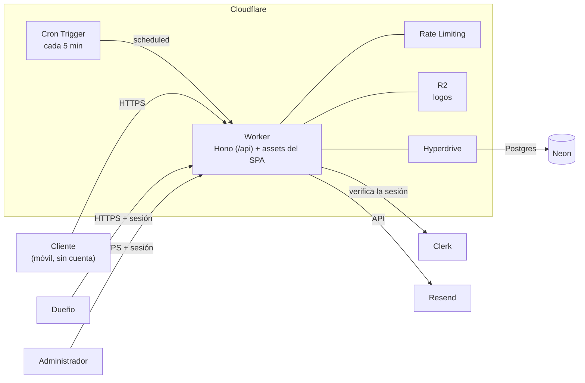

# Agenda de citas (SaaS) — Stack tecnológico

| | |
|---|---|
| **Versión** | 0.1 (borrador) |
| **Fecha** | 2026-11-10 |
| **Fuentes** | [EPICS.md](EPICS.md) v0.1 · ARCHITECTURE.md v0.14 (proyecto anterior) |

> Este documento fija **con qué** se construye el producto. Las piezas **definidas** ya estaban decididas antes de este documento (Resend, Clerk y Cloudflare). Las **propuestas** salen de las épicas y de lo aprendido en el proyecto anterior.

---

## 1. Resumen

Un solo **Cloudflare Worker** con **Hono** para la API y un SPA de **React + Vite** para las pantallas. Los datos van en **Neon Postgres** con **Hyperdrive** y **Drizzle**, la identidad del dueño y del administrador en **Clerk**, y los correos salen por **Resend**.

---

## 2. Stack por capa

| Capa | Elección | Por qué | Estado |
|---|---|---|---|
| **Despliegue** | Un solo Worker: Hono atiende `/api/*` (`run_worker_first`) y Workers Static Assets sirve el SPA construido por Vite en `apps/web/dist`. | Un despliegue, un dominio, sin CORS y con la cookie de Clerk en el mismo origen. Evita OpenNext y su costo de CPU. | **Definido** |
| **Backend** | Hono + TypeScript estricto | Liviano y nativo de Workers. El handler `scheduled` del cron vive en el mismo Worker. | **Definido** |
| **Validación** | Zod | Mismos esquemas en la API y en los formularios. | Propuesto |
| **Frontend** | React + Vite | El panel y el admin no necesitan SEO. | **Definido** |
| **Rutas del SPA** | React Router en modo SPA | Página pública, panel y admin en un mismo SPA. | Propuesto |
| **Página pública `/{slug}`** | Bundle separado del panel, sin Clerk. Hono inyecta título y meta OG por negocio con `HTMLRewriter`. | LCP < 2,5 s en 4G (RNF-01, RES-01) y vista previa correcta al compartir el link por WhatsApp. | Propuesto |
| **UI** | shadcn/ui + Tailwind CSS v4, con variables CSS para la marca de cada negocio | Marca propia por negocio (NEG-01) y una base accesible para WCAG 2.1 AA. | **Definido** |
| **Datos del servidor** | TanStack Query | Caché, carga, errores y reintentos en el panel y en la reserva. | Propuesto |
| **Formularios** | React Hook Form + Zod, con los mismos esquemas que el backend | Validación tipada y errores junto a cada campo (RES-05). | Propuesto |
| **Autenticación** | Clerk: `@hono/clerk-auth` en la API, SDK de React en el panel, localización `esES`. Registro solo por invitación. | Identidad del dueño y del administrador (M1). La pertenencia al negocio vive en la base, no en Clerk. | **Definido** |
| **Base de datos** | Neon Postgres, conectado por Hyperdrive | El motor necesita transacciones interactivas, `SELECT … FOR UPDATE`, `SKIP LOCKED` y triggers de auditoría (DIS-06, NOT-06, SUS-04). | Propuesto |
| **ORM y migraciones** | Drizzle + Drizzle Kit, con migraciones SQL versionadas en el repo | API cercana a SQL y tipos sacados del esquema. | Propuesto |
| **Correo** | Resend + React Email, con bandeja de salida en Postgres | Un envío por correo, con reintentos (NOT-06). | **Definido** (Resend) |
| **Tareas programadas** | Cloudflare Cron Triggers, cada 5 minutos | Recordatorios, asistencia automática y vencimientos (NOT-02, AGE-07, SUS-02). | **Definido** |
| **Límite de frecuencia** | Binding de Rate Limiting de Workers + campo trampa | Frena las reservas basura (RES-08). | **Definido** |
| **Antibots** | Cloudflare Turnstile en el formulario de reserva | Refuerzo de RES-08 sin otro proveedor. | Opcional |
| **Archivos** | Cloudflare R2 | Logos de los negocios (NEG-02). | **Definido** |
| **Fechas** | `date-fns` + `@date-fns/tz`; `Intl.DateTimeFormat` para mostrar | UTC al guardar, `America/Bogota` al mostrar (RN-03). | Propuesto |
| **Teléfonos** | `libphonenumber-js` (país por defecto: CO) | Normalización para reconocer al cliente (CLI-01). | Propuesto |
| **Calendarios** | Archivos `.ics` generados en el código, con `UID` estable | Invitación, cambio y cancelación del mismo evento (NOT-01, NOT-03, NOT-05). | Propuesto |

---

## 3. Calidad y pruebas

| Nivel | Herramienta | Qué cubre |
|---|---|---|
| Unitario | Vitest | El dominio puro: disponibilidad, estados de la cita, plazos, suscripción y tiempo. |
| Worker | Vitest con `@cloudflare/vitest-pool-workers` | Rutas de Hono, cron y bindings. |
| Integración | Vitest + Testcontainers con Postgres real | Reserva concurrente (10 solicitudes por el último cupo), bandeja de salida y triggers. |
| End-to-end | Playwright | Tres flujos: reservar, gestionar la cita por link y operar la agenda en el panel. |
| Estilo | ESLint + Prettier, con `no-restricted-imports` para las reglas de dependencia | Que `dominio` no importe I/O ni frameworks. |

---

## 4. Repositorio, CI/CD y operación

| Tema | Elección |
|---|---|
| **Gestor de paquetes** | pnpm workspaces, por Corepack (**Definido**) |
| **Estructura** | Monorepo (**Definido**): `apps/worker` (Hono) y `apps/web` (React + Vite). Se agregan cuando una historia los necesite: `packages/dominio` (lógica pura), `packages/db` (esquema y migraciones de Drizzle) y `packages/emails` (plantillas de React Email). |
| **CI/CD** | GitHub Actions (**Definido**): tipos y build en cada PR y en cada push a `main`; `wrangler deploy` a producción en `main`. Lint, pruebas y ambiente de preview se suman cuando se confirmen sus herramientas. |
| **Entornos** | Local (`wrangler dev` + rama de Neon), preview y producción, cada uno con su rama de Neon y su instancia de Clerk |
| **Secretos** | `wrangler secret` en Cloudflare y secretos del repo en GitHub. Nunca en el código. |
| **Observabilidad** | Workers Logs, sin datos personales, y alerta de correos atrasados en `/admin` (OPE-06). Sentry, más adelante. |
| **Plan de Cloudflare** | Workers Paid desde el primer despliegue con clientes: el límite de 10 ms de CPU del plan gratuito no alcanza. |

---

## 5. Descartado

| Opción | Motivo |
|---|---|
| Next.js con OpenNext | En el proyecto anterior tuvo un Worker de 15,6 MB, de 12 a 44 ms de CPU por solicitud, casi todo del framework, y error 1102. El `proxy.ts` de Clerk solo funciona en Workers como función experimental. |
| Cloudflare D1 | Es SQLite y no tiene transacciones interactivas: no garantiza la regla de cero dobles reservas (DIS-06). |
| Driver serverless de Neon (HTTP + WebSocket) | Hyperdrive permite usar un driver de Postgres estándar con pooling, y transacciones sin crear un `Pool` por solicitud. |
| Prisma | Más pesado en Workers y con menos control del SQL (`FOR UPDATE`, `SKIP LOCKED`). |
| Clerk Organizations | La pertenencia y el rol viven en la base, junto a los datos del negocio. |

---

## 6. Verificar el día 1

Antes de construir funcionalidades, se despliega un esqueleto que demuestre:

1. Que la sesión de Clerk se lee en Hono y que `/panel` exige sesión.
2. Una reserva dentro de una transacción con `FOR UPDATE` a través de Hyperdrive, con 10 solicitudes en paralelo.
3. Que el cron ejecuta el handler `scheduled`.
4. El CPU por solicitud y el LCP de la página pública en un celular con 4G.
